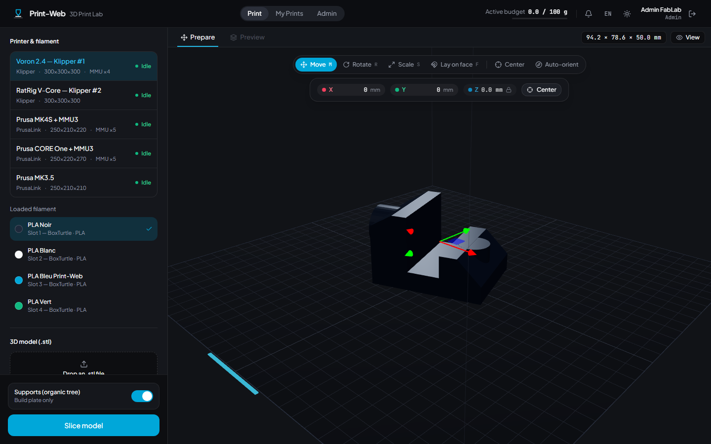
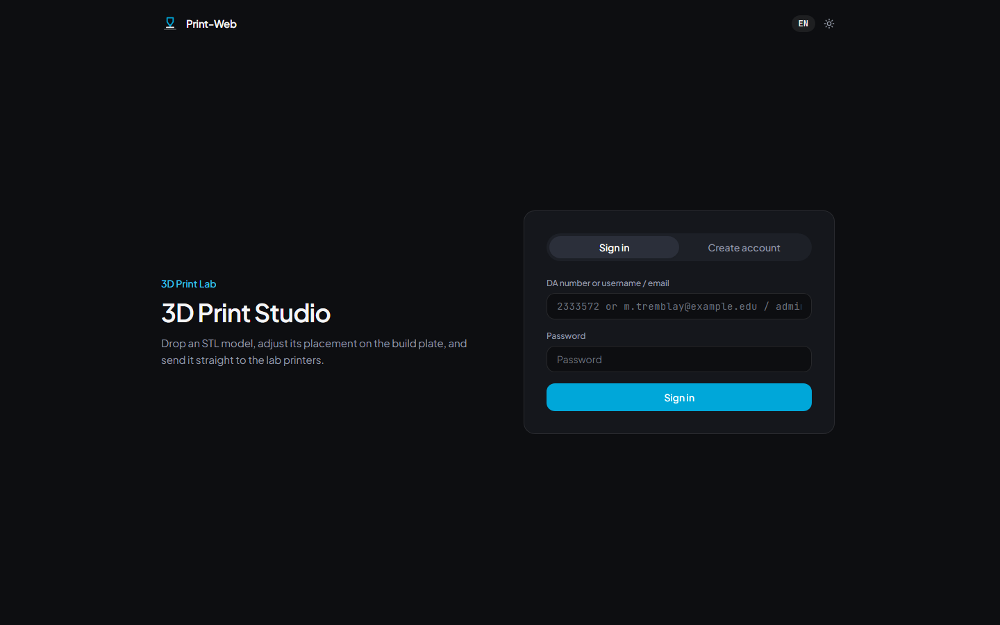
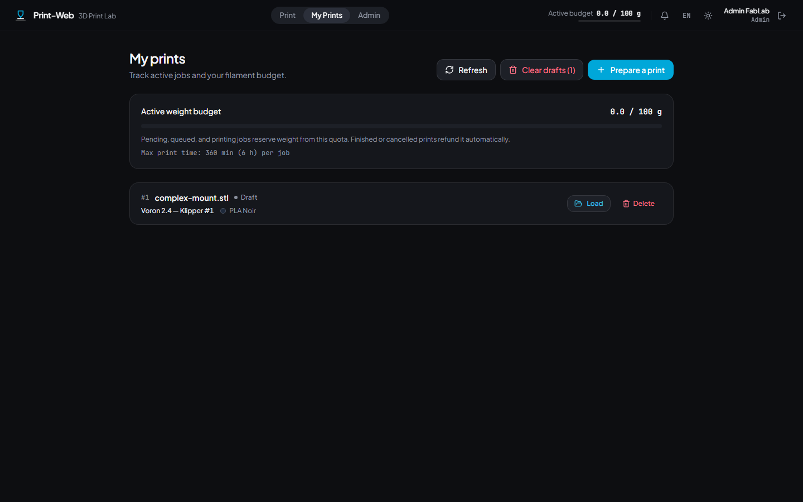
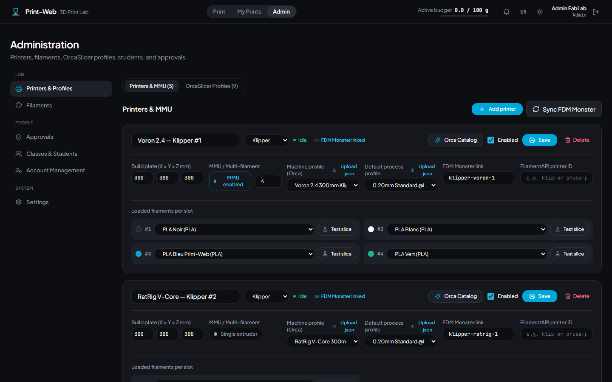
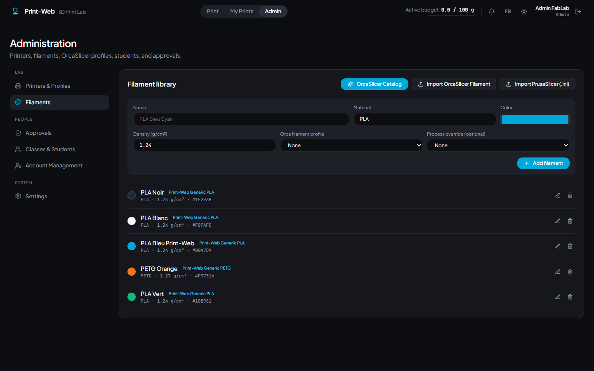

# Print-Web

[](https://github.com/yashTheBabyDragon/GGPrint-Web/actions/workflows/ci.yml)
[](https://github.com/yashTheBabyDragon/GGPrint-Web/actions/workflows/release-docker.yml)
[](https://github.com/yashTheBabyDragon/GGPrint-Web/actions/workflows/release.yml)
[](LICENSE)

Print-Web is a self-service 3D printing portal for 3D Print Lab with a French/English interface. Students upload `.stl` models, orient them on a Three.js build plate, stay within an active filament weight budget, and submit jobs to Klipper or PrusaLink printers managed by FDM Monster.



## What It Includes

- Three.js build plate with flat-face orientation, drag/rotate/scale controls, bounding-box fit checks, and a mobile layout.
- Draft persistence so users can save, compare slicing estimates, and resume models before submitting.
- Filament weight budget tracking (100 g default) with automatic refunds on job completion or cancellation, plus oversized-part approval requests.
- Teacher workspace for managing classes, student DA whitelists, per-student filament limits, and class print queues.
- Role-based access control (Student, Teacher, Admin) with permission presets and per-user overrides.
- OrcaSlicer `.json` and selective PrusaSlicer `.ini` profile import, bound to printers and MMU slots.
- Live printer and MMU slot sync with FDM Monster and FilamentAPI.
- Docker Compose production stack (`postgres:16-alpine`, FastAPI backend, Nginx frontend) with pre-built `linux/amd64` and `linux/arm64` images on GHCR.

## Supported Architectures

Pre-built container images in GitHub Container Registry (`ghcr.io/yashthebabydragon/print-web-backend` and `ghcr.io/yashthebabydragon/print-web-frontend`) support:

| Architecture | Targets |
| --- | --- |
| `linux/amd64` | x86_64 servers, VMs, Proxmox LXC/VM |
| `linux/arm64` | Raspberry Pi 4/5 (64-bit OS), ARM64 servers |

## Quick Start

### Debian, Ubuntu, and Raspberry Pi OS (Docker Installer)

Run on Debian 11/12/13, Ubuntu 22.04/24.04, or 64-bit Raspberry Pi OS:

```bash
curl -fsSL https://raw.githubusercontent.com/yashTheBabyDragon/Print-Web/main/deploy/install-debian.sh | sudo bash
```

Optional environment overrides (for example domain and HTTP port):

```bash
curl -fsSL https://raw.githubusercontent.com/yashTheBabyDragon/Print-Web/main/deploy/install-debian.sh \
  | sudo PRINT_WEB_DOMAIN=print-web.example.edu PRINT_WEB_HTTP_PORT=80 bash
```

The installer installs Docker Engine and the Compose plugin, clones the repository to `/opt/print-web`, generates `/opt/print-web/.env` with random `JWT_SECRET` and `POSTGRES_PASSWORD` values, pulls the GHCR images, starts the containers, enables the on-demand `print-web-update.path` unit, and checks `http://127.0.0.1:8000/api/health`.

### Manual Docker Compose

```bash
git clone https://github.com/yashTheBabyDragon/GGPrint-Web.git
cd GGPrint-Web
cp deploy/.env.production.example .env
# Edit .env to set POSTGRES_PASSWORD, JWT_SECRET, and CORS_ORIGINS
chmod 600 .env
docker compose pull
docker compose up -d --no-build
```

Production updates are manual and on-demand only. Admins or users with `updates:manage` can trigger an update from the Admin UI or run `sudo /opt/print-web/deploy/update-from-release.sh` over SSH.

### Local Development

Prerequisites: Python 3.13+ and Node.js 20+.

On Windows, run `start-dev.bat` or:

```powershell
powershell -NoProfile -ExecutionPolicy Bypass -File .\start-dev.ps1
```

On Linux or macOS:

```bash
# Terminal 1: Backend (http://127.0.0.1:8000)
cd backend
python3 -m venv .venv
source .venv/bin/activate
pip install -e ".[dev]"
DEV_SEED=true uvicorn app.main:app --reload --host 127.0.0.1 --port 8000

# Terminal 2: Frontend (http://localhost:5173)
cd frontend
npm ci
npm run dev
```

## Screenshots

| View | Preview |
| --- | --- |
| Sign-In and Registration |  |
| My Prints and Weight Budget |  |
| Admin Printers and MMU |  |
| Filaments and Slicer Profiles |  |

## Documentation (Wiki)

| Page | Topics |
| --- | --- |
| [Home](https://github.com/yashTheBabyDragon/GGPrint-Web/wiki) | Role-based navigation and overview |
| [Student Guide](https://github.com/yashTheBabyDragon/GGPrint-Web/wiki/Student-Guide) | Registration, 3D plate controls, slicing, drafts, weight budgets, and print submission |
| [Teacher Guide](https://github.com/yashTheBabyDragon/GGPrint-Web/wiki/Teacher-Guide) | Classes, student DA whitelists, per-student limits, and oversized-part approvals |
| [Troubleshooting](https://github.com/yashTheBabyDragon/GGPrint-Web/wiki/Troubleshooting) | Common errors, slicer and FDM Monster diagnostics, and web updater checks |
| [Installation](https://github.com/yashTheBabyDragon/GGPrint-Web/wiki/Installation) | Debian/Raspberry Pi installer, manual Docker Compose, and reverse proxy setup |
| [Configuration](https://github.com/yashTheBabyDragon/GGPrint-Web/wiki/Configuration) | Environment variables, `.env` settings, and initial admin bootstrap |
| [Printers and OrcaSlicer](https://github.com/yashTheBabyDragon/GGPrint-Web/wiki/Printers-and-OrcaSlicer) | FDM Monster integration, MMU slots, OrcaSlicer and PrusaSlicer profiles |
| [Users and Permissions](https://github.com/yashTheBabyDragon/GGPrint-Web/wiki/Users-and-Permissions) | Roles, RBAC permission keys, classes, and filament budgets |
| [Updating](https://github.com/yashTheBabyDragon/GGPrint-Web/wiki/Updating) | On-demand UI and CLI updates, PostgreSQL backups, and rollback |
| [Development](https://github.com/yashTheBabyDragon/GGPrint-Web/wiki/Development) | Local setup, pytest, Vitest, TypeScript build, and shell checks |

## License

Original Print-Web source code, documentation, and assets are licensed under the [PolyForm Noncommercial License 1.0.0](https://polyformproject.org/licenses/noncommercial/1.0.0) (see [LICENSE](LICENSE)).

Third-party components, including OrcaSlicer (GNU AGPL-3.0), `psycopg2-binary` (GNU LGPL-3.0), Python/npm dependencies, and container base packages, are excluded from the PolyForm Noncommercial License 1.0.0 and remain under their respective licenses. See [THIRD_PARTY_LICENSES.md](THIRD_PARTY_LICENSES.md) for the full notice list.
